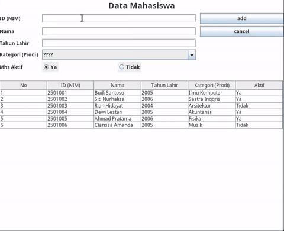

Saya Muhammad Rusydi Akramallah dengan NIM 2508255 mengerjakan TP 4 dalam mata kuliah Desain dn Pemrograman Berorientasi Objek untuk keberkahanNya maka saya tidak melakukan kecurangan seperti yang telah dispesifikasikan. Aamiin

---

## Spesifikasi Teknis & Komponen GUI

### 1. Class Model (`Person.java`)

Class `Person` berfungsi sebagai penampung struktur data dengan atribut privat beserta method *getter-setter*:

* `id` (`String`): ID / NIM Mahasiswa.
* `nama` (`String`): Nama Mahasiswa.
* `tahun` (`int`): Tahun lahir.
* `kategori` (`String`): Program Studi.
* `aktif` (`boolean`): Status keaktifan.
* `semester` (`int`): Semester mahasiswa saat ini *(Atribut baru penunjang komponen GUI JSpinner)*.

### 2. Form & Komponen Interface (`PeopleMenu.java` & `PeopleMenu.form`)

* `idField`, `namaField`, `tahunField`: Component `JTextField` untuk input data string dan angka.
* `kategoriComboBox`: Component `JComboBox<String>` untuk pemilihan opsi prodi.
* `yaRadioButton`, `tidakRadioButton`: Component `JRadioButton` dalam `ButtonGroup` untuk variabel `boolean aktif`.
* `semesterSpinner`: Component `JSpinner` (`SpinnerNumberModel` min: 1, max: 14) sebagai komponen penanda variabel `semester`.
* `personTable`: Component `JTable` penampil data `ArrayList<Person>` berbasis `DefaultTableModel` non-editable.
* `addUpdateButton`, `deleteButton`, `cancelButton`: Component `JButton` terikat pemicu `ActionListener`.

---

## Penjelasan Alur Kerja & Logika Program

### 1. Inisialisasi & Render Data (Read)

* Method `populateList()` mengisi `ArrayList<Person>` dengan data dummy saat aplikasi pertama diinstansiasi.
* Method `setTable()` mengekstrak seluruh properti objek `Person` di `ArrayList` ke dalam bentuk array dari objek (`Object[]`), memasukkannya ke `DefaultTableModel`, lalu mengikat model tersebut ke `personTable`.

### 2. Penambahan Data Baru (Create)

* Dipicu oleh tombol `addUpdateButton` saat variabel `selectedIndex == -1`.
* Method `insertData()` membaca input dari setiap komponen GUI, mengonversi nilai angka, membuat instance objek `Person` baru, lalu menyimpannya ke `ArrayList<Person>`.
* Setelah penambahan, tampilan tabel di-render ulang melalui `setTable()` dan form dibersihkan via `clearForm()`.

### 3. Pemilihan & Pembaruan Data (Update)

* Event `mouseListener` pada `personTable` mendeteksi baris yang diklik untuk menyimpan indeks ke `selectedIndex`.
* Nilai dari kolom tabel diisikan kembali ke dalam komponen input terkait. Label `addUpdateButton` berganti menjadi `"Update"`, dan `deleteButton` ditampilkan (`setVisible(true)`).
* Saat `addUpdateButton` diklik ketika `selectedIndex != -1`, method `updateData()` memperbarui properti objek `Person` pada indeks terkait di `ArrayList`.

### 4. Penghapusan Data (Delete)

* Dipicu oleh `deleteButton`.
* Sebelum eksekusi, logika memanggil `JOptionPane.showConfirmDialog()` dengan modal dialog konfirmasi `YES_NO_OPTION`.
* Jika respon bernilai `YES_OPTION`, method `deleteData()` menghapus objek terkait dari `ArrayList` berdasarkan `selectedIndex`, merefresh tabel, dan mereset status form.

### 5. Reset Status Form (Cancel / Clear)

* Method `clearForm()` mereset isi `JTextField`, mengembalikan `JSpinner` ke nilai default (1), mengembalikan label tombol utama menjadi `"Add"`, menyembunyikan `deleteButton`, serta mengembalikan `selectedIndex = -1`.

---

## Dokumentasi Pengujian Fungsi CRUD

